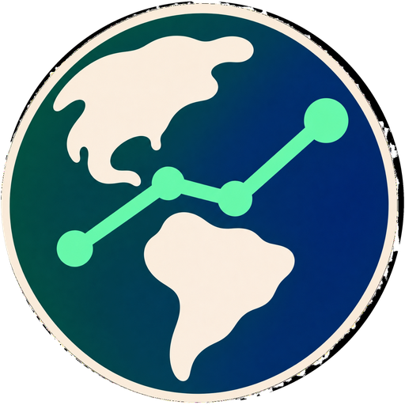

  
  <h1>TerraScope</h1>
  
<strong>Explora la Tierra. Comprueba el cambio. Entiende la evidencia.</strong>

  
Datos ambientales de la NASA, análisis estadístico y una IA que te ayuda a interpretar los resultados.

  
<strong>Español · English</strong> &nbsp;|&nbsp; Perú y el mundo &nbsp;|&nbsp; The Innovators YF

  

    <a href="#qué-resuelve">Qué resuelve</a> ·
    <a href="#funciones-principales">Funciones</a> ·
    <a href="#instalación">Instalación</a> ·
    <a href="#killa-e-inteligencia-artificial">Killa e IA</a>
  

---

## Qué resuelve

Interpretar una gráfica ambiental exige más que observar si una línea sube o baja. Hace falta conocer la fuente, distinguir una tendencia de la variación habitual y entender la incertidumbre.

**TerraScope reúne ese recorrido en una aplicación:** eliges un lugar, consultas sus datos, contrastas el cambio con pruebas estadísticas y exploras sus implicaciones con ayuda de Killa. El proyecto está inspirado en el reto de investigar tendencias del sistema Tierra de NASA Space Apps.

## Funciones principales

| Sección | Qué puedes hacer |
| --- | --- |
| **Explorar** | Recorrer el planeta 3D de Cesium, elegir lugares y consultar capas satelitales y eventos naturales. |
| **Laboratorio** | Investigar una variable paso a paso, importar series, comparar lugares y revisar tendencias, anomalías y pronósticos. |
| **Decisiones** | Interpretar el semáforo, comparar tres escenarios con incertidumbre y consultar el pasaporte de evidencia. |
| **Lagos del Perú** | Explorar el inventario, el balance climático, la similitud entre lagos, las escenas disponibles y los reportes locales. |
| **Killa IA** | Conversar sobre cualquier tema en español o inglés y recibir orientación sobre las herramientas del programa. |
| **Aprender** | Practicar con lecciones, simuladores, juegos y explicaciones de los resultados. |
| **Proyecto** | Conocer los objetivos, las brechas que atiende la plataforma, las fuentes y el equipo. |

**Centinela** complementa estas herramientas: mientras la aplicación está abierta y la vigilancia está activa, revisa los lagos, identifica cambios respecto a su historia y registra hallazgos y verificaciones.

### Recorrido para conocer el proyecto

1. Abre **Explorar** y selecciona un lugar en el mapa.
2. Entra al **Laboratorio**, elige una variable y revisa sus pruebas estadísticas.
3. Abre **Decisiones** para comparar escenarios y consultar la evidencia.
4. Usa el botón de **Killa** junto a un gráfico o una tabla para pedir su interpretación.
5. Prueba **Aprender** o activa **Práctica** para explorar con datos simulados identificados como tales.

## Killa e inteligencia artificial

Killa tiene dos espacios de consulta:

- **Chat general:** preguntas sobre redacción, programación, ciencia, aprendizaje, TerraScope u otros temas. Responde en español o inglés, sin asumir una ubicación.
- **Interpretación de resultados:** explica gráficos, tablas y escenarios usando el contexto disponible del análisis.

El modo en línea utiliza **Groq** a través de una función de servidor. La aplicación también permite configurar Ollama, Claude o guías locales. Cada respuesta identifica su procedencia.

Puedes escribir en varias líneas, detener y reintentar consultas, copiar respuestas y descargar la conversación. El historial y el borrador se conservan al cambiar de sección durante el uso de la aplicación.

 

## Cómo funciona

~~~mermaid
flowchart LR
    N["NASA y archivos CSV"] --> A["Análisis en el navegador"]
    A --> R["Mapas, series y escenarios"]
    R -->|Contexto del resultado| API["API del servidor"]
    P["Preguntas generales"] --> API
    API --> G["Groq"]
    G --> K["Respuesta de Killa"]
~~~

Las consultas de interpretación se realizan cuando las solicitas. Los cálculos estadísticos se ejecutan en el navegador, con tareas de análisis en segundo plano.

**Métodos incluidos:** Mann–Kendall, pendiente de Sen e intervalo de confianza, regresión con prueba t, Pettitt, autocorrelación, corrección TFPW, bootstrap, comparación de series y corrección por pruebas múltiples.

## Instalación

**Requisitos:** Node.js compatible con Vite y npm. Se admiten Node.js 20 desde la versión 20.19 y Node.js 22 desde la versión 22.12, además de versiones posteriores compatibles.

~~~bash
npm ci
npm run dev
~~~

Abre la dirección que indique Vite en la terminal.

| Comando | Uso |
| --- | --- |
| `npm run dev` | Inicia el entorno de desarrollo. |
| `npm run build` | Genera la aplicación de producción en `dist/`. |
| `npm run preview` | Permite revisar la compilación estática. |
| `npm test` | Ejecuta las pruebas automatizadas. |
| `npm run datos` | Actualiza la instantánea de datos climáticos. |

Las pruebas cubren datos y CSV, navegación, consultas asíncronas, mapas Cesium, explicaciones, chats y API. Las pruebas del proveedor de IA utilizan respuestas controladas.

### Configurar Groq

El análisis estadístico puede utilizarse sin una clave de IA. Para consultar los modelos de Groq:

1. Crea una clave desde la consola de Groq.
2. Configura `GROQ_API_KEY` como variable del **servidor** en Vercel.
3. Publica la aplicación con esa configuración y envía una pregunta en Killa.

Usa [.env.example](.env.example) como referencia. `GROQ_MODEL` es opcional: permite indicar un modelo preferido; el servidor dispone de modelos de respaldo y reintentos limitados.

**La clave no se incluye en el frontend ni debe usar el prefijo `VITE_`.**

El servidor estático de Vite y `npm run preview` no ejecutan `/api/chat`. Para probar esa función localmente, utiliza un entorno compatible con las funciones de Vercel y sus variables de servidor, como `vercel dev`.

<strong>Configuración opcional de cuotas</strong>

La API admite `CHAT_REQUESTS_PER_MINUTE` y `CHAT_GLOBAL_REQUESTS_PER_MINUTE`.

Para compartir la cuota entre instancias, configura `UPSTASH_REDIS_REST_URL` y `UPSTASH_REDIS_REST_TOKEN`. También se admiten `KV_REST_API_URL` y `KV_REST_API_TOKEN`.

Con `CHAT_REQUIRE_SHARED_LIMIT=true`, la consulta se rechaza si el servicio de cuota compartida no está disponible. Sin ese requisito se aplica un límite por instancia.

## Datos y archivos propios

La plataforma utiliza NASA POWER para series climáticas, NASA GIBS para imágenes, EONET para eventos y Earthdata CMR para buscar productos y escenas. La sección **Proyecto → Datos en vivo** permite explorar las fuentes y comprobar su respuesta.

- Importa series mensuales con columnas `year,month,value` o `fecha,valor`.
- Sustituye el inventario de referencia mediante un CSV de lagos.
- Importa puntos de monitoreo para revisar su cobertura.
- Actualiza la instantánea con `npm run datos` o utiliza `npm run datos -- archivo.csv` para un inventario propio.

Plantillas disponibles: [lagos](public/plantillas/lagos-plantilla.csv) y [puntos de monitoreo](public/plantillas/puntos-plantilla.csv).

## Alcance de los resultados

- El balance lluvia − evaporación es un **indicador climático**, no el nivel ni el volumen medido de un lago.
- Los escenarios dependen de sus condiciones y muestran incertidumbre. Los índices de riesgo y confianza se distinguen de las probabilidades simuladas.
- El inventario incluido es de referencia y puede reemplazarse por datos oficiales.
- Las consultas en vivo dependen de las fuentes externas. Una copia histórica conserva su procedencia; Práctica utiliza simulaciones explícitas.
- Los reportes ciudadanos se guardan localmente. La persistencia compartida y nuevas integraciones de observación forman parte de la ampliación del proyecto.
- Las explicaciones de IA ayudan a interpretar la evidencia y requieren revisión. Los resultados apoyan la investigación y la validación en campo.

## Tecnologías y estructura

| Área | Herramientas |
| --- | --- |
| Interfaz | React, Vite, Mantine, Zustand, Framer Motion y GSAP. |
| Mapas | CesiumJS y MapLibre con fuentes NASA. |
| Visualización | ECharts, Plotly, Observable Plot, D3, visx, Nivo y SciChart. |
| IA en línea | Función Node y Groq. |
| Validación | Vitest y Testing Library. |

~~~text
api/             Entrada de la API para Vercel
server/          Integración con el proveedor y control de consultas
src/
  core/          Estado, idioma, navegación y gestión de tareas
  features/      Módulos de la aplicación
  shared/        Mapas, análisis y gráficos compartidos
  killa/         Mascota y componentes de Killa
  layout/        Navegación y estructura de las vistas
  lib/           Estadística, datos y acceso a fuentes
  ui/            Componentes y efectos visuales
  test/          Pruebas automatizadas
public/          Recursos estáticos, datos y plantillas
scripts/         Descarga y preparación de datos
~~~

## Equipo y atribuciones

**The Innovators YF · Puno, Perú**

- Flor Melany Yanarico Huanca.
- Yeferson Dariun Laura Livise.

Los componentes de React Bits conservan su [licencia original](src/ui/react-bits/LICENSE.md) y [atribución](src/ui/react-bits/README.md). Las demás dependencias mantienen sus licencias correspondientes.
